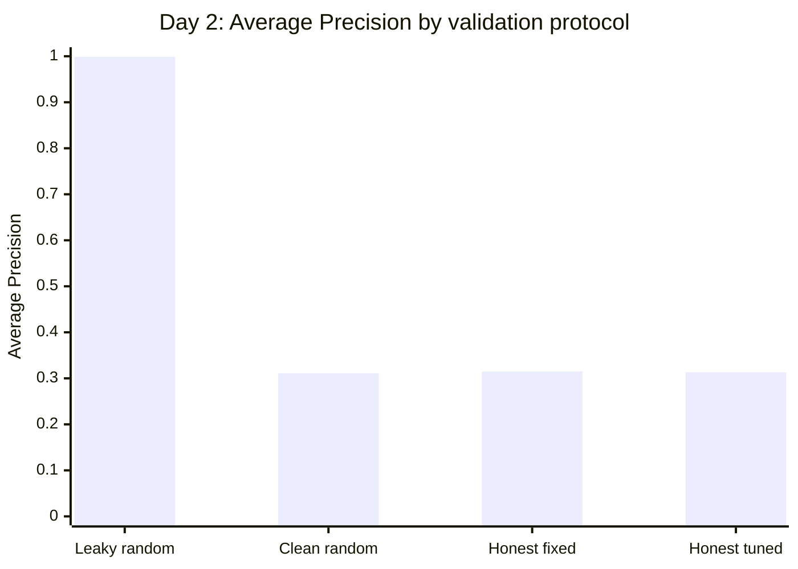
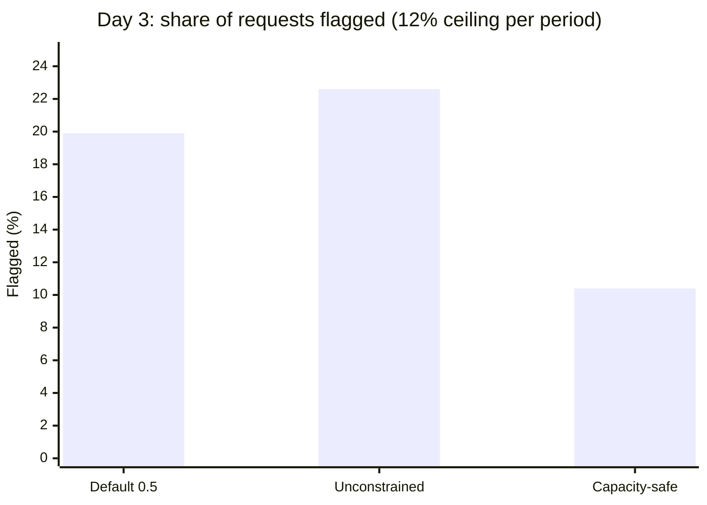
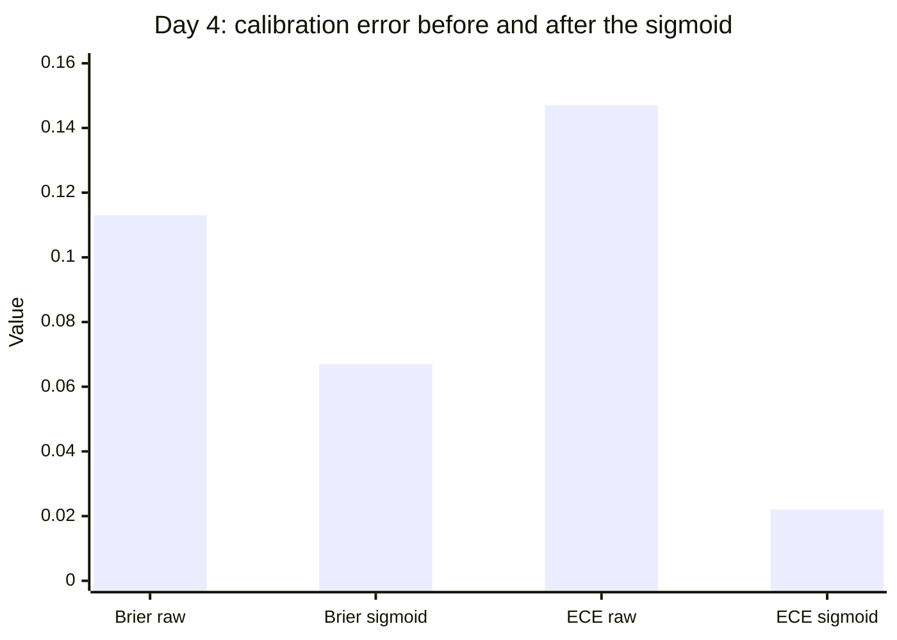
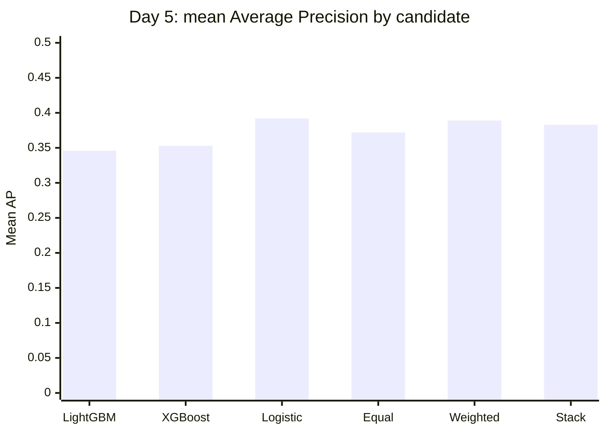

# Tamweel | SDAIA

Credit-risk project for SDA-DSC-211: predict whether a synthetic applicant defaults within 90 days of applying (`default_within_90d`) using only information available at application time. All data is synthetic; nothing here is deployment evidence.

## Repository structure

```text
README.md
notebooks/01_baseline_boosting.ipynb        Day 1: model comparison
notebooks/02_validation_tuning.ipynb        Day 2: honest validation and tuning
notebooks/03_cost_sensitive_decision.ipynb  Day 3: cost-sensitive threshold
notebooks/04_explain_calibrate.ipynb        Day 4: explanation and calibration
notebooks/05_final_model.ipynb              Day 5: final model and delivery
artifacts/                                  Evidence files (CSV, JSON, PNG)
reports/                                    Decision card, interpretability report, model card
submission/                                 submission.csv and project bundle
```

## How to run

Open a notebook in Google Colab (free CPU) and choose **Runtime → Run all**. On a fresh session the first cell installs the pinned packages and restarts once; if a "session crashed" notice appears, choose **Run all** again. Seed 211; tiny last-decimal and timing differences are normal.

## Results at a glance

| Day | Topic | Headline result |
|---|---|---|
| 1 | Baseline vs. boosting | ROC-AUC 0.81-0.82 for all three models; differences within noise |
| 2 | Honest validation | Leaky AP 0.999 falls to 0.31 once leakage is removed |
| 3 | Decision threshold | 0.5 breaks the 12% capacity; capacity-safe threshold 0.658 |
| 4 | Explain and calibrate | `bureau_score` leads; Brier 0.113 → 0.067, ECE 0.147 → 0.022 |
| 5 | Final model | KEEP SINGLE: Logistic Regression (mean AP 0.392); 300 flags of 2,500 |



## Day 1: baseline vs. boosting

| Model | ROC-AUC | AP | Train time | Trees |
|---|---:|---:|---:|---:|
| Logistic Regression | 0.821 | 0.326 | 0.04 s | - |
| XGBoost | 0.812 | 0.334 | 0.38 s | 61 |
| LightGBM | 0.814 | 0.325 | 0.24 s | 41 |


## Day 2: honest validation and tuning

| Protocol | ROC-AUC | AP | Rows scored |
|---|---:|---:|---:|
| Leaky random (unsafe) | 0.9999 | 0.9988 | 10,000 |
| Clean random (unsafe) | 0.801 | 0.311 | 10,000 |
| Honest, fixed 80 trees | 0.798 | 0.315 | 5,039 |
| Honest, reserved search | 0.786 | 0.313 | 5,039 |


## Day 3: cost-sensitive decision

Policy: a missed default (FN) costs 10 teaching units, a false alarm (FP) costs 1, and no validation period may flag more than 12% of requests. Class-weighted LightGBM, 5,039 out-of-fold requests.

| Rule | Threshold | Flagged | Recall | Precision | Loss (units) | Within capacity |
|---|---:|---:|---:|---:|---:|:---:|
| Default 0.5 | 0.5000 | 1,005 (19.9%) | 57.8% | 22.1% | 2,403 | No |
| Min. loss, no capacity limit | 0.4486 | 1,141 (22.6%) | 64.1% | 21.6% | 2,275 | No |
| Min. loss, every period ≤ 12% | 0.6583 | 526 (10.4%) | 40.9% | 29.9% | 2,639 | Yes |




## Day 4: explanation and calibration

| Evidence | Value |
|---|---|
| Top feature (mean abs SHAP, log-odds) | `bureau_score` 0.904, then `dti` 0.544 |
| Held-out AP drop when shuffled | `bureau_score` 0.127, then `dti` 0.069 |
| Brier, raw → sigmoid | 0.1130 → 0.0671 |
| ECE, raw → sigmoid | 0.1469 → 0.0225 |
| Review zone | `CAPACITY_REVIEW_REQUIRED` (a valid outcome) |




## Day 5: final model and delivery

Three single models, equal averaging, weighted averaging and stacking were compared on three forward folds (2023Q1, 2023Q3, 2024Q1). An ensemble would be accepted only if its AP gain exceeded the best single model's fold SD (0.030) without a worse Brier or ECE.

| Candidate | Mean AP | Fold SD | Brier | ECE | AP change vs best single |
|---|---:|---:|---:|---:|---:|
| Logistic Regression | 0.392 | 0.030 | 0.0633 | 0.0188 | 0 |
| LightGBM | 0.346 | 0.044 | 0.0661 | 0.0231 | -0.046 |
| XGBoost | 0.353 | 0.029 | 0.0657 | 0.0228 | -0.039 |
| Equal average | 0.372 | 0.033 | 0.0643 | 0.0204 | -0.020 |
| Weighted average | 0.389 | 0.029 | 0.0633 | 0.0177 | -0.002 |
| Stacking | 0.383 | 0.030 | 0.0660 | 0.0311 | -0.009 |

**Decision: KEEP SINGLE (Logistic Regression).** Challenge batch: 330 of 2,500 requests passed the threshold and the 12% cap kept 300.




## Daily answers | الإجابات اليومية

### Day 1 | اليوم الأول

**Initial candidate:** LightGBM.

**Strongest evidence:** on the 2,000 untouched comparison rows LightGBM reached ROC-AUC 0.814 and Average Precision 0.325, and trained faster than XGBoost (0.24 s vs 0.38 s, 41 trees). The paired bootstrap showed no significant difference between the three models, so it is a practical initial choice, not a proven winner.

**Limitation and next step:** one random split, with 1,226 customers on both sides and no time ordering. Day 2 uses customer-grouped, time-ordered validation.

### Day 2 | اليوم 2

**Leakage risk:** `days_past_due_60` and `collection_calls` are recorded only after the application, so they leak the outcome. Keeping them inflated AP to 0.9988; the clean random control gave 0.311.

**How the validation design prevented it:** I dropped both fields and checked for duplicate events (none). I used three time-ordered folds with a label-maturity rule (application date + 90 days < validation start), removed each fold's validation customers from training (0 shared), learned imputation inside training only, and tuned on a separate older cohort before reading any outer result.

**Limitations:** small, related folds (5,039 out-of-fold rows, 50.39% coverage); tuning did not help (AP 0.313 vs 0.315 fixed). Not a final independent test.

### Day 3 | اليوم الثالث

**Why is a fixed threshold of 0.5 not always suitable for this review policy?**

Because 0.5 ignores the policy. Here a missed default costs 10 times a false alarm, only about 7.6% of requests are defaults, the scores come from a class-weighted model (so they are not calibrated probabilities), and each period may flag at most 12% of requests. At 0.5 the model flagged 1,005 requests (19.9%), and its busiest period reached 23.2%, so the capacity rule was broken. The loss-minimising threshold without a limit (0.4486) is cheaper (2,275 units) but flags even more (22.6%). Choosing the lowest-loss threshold that keeps every period within 12% gave 0.6583: 526 flags (10.4%), recall 40.9%, precision 29.9%, and 2,639 units, which is 236 units more than 0.5 but the only option that respects capacity. So the threshold must come from the loss and capacity policy, not from a default.

**Limitations:** the threshold and its loss were estimated on the same out-of-fold outcomes (a development result, not a final test); loss is in teaching units, not money; a flag means "send to review", not rejection.

### Day 4 | اليوم الرابع

**Which feature was most important in your explanation, and why does that not prove causation?**

`bureau_score` was the most important feature. It had the largest mean absolute SHAP value (0.904 log-odds, against 0.544 for `dti`), the largest held-out Average Precision drop when shuffled (0.127 from a baseline of 0.259), and it was the top contribution (+2.27 log-odds) for the highest-scoring request I explained. This does not prove causation because SHAP and permutation importance only describe what the model relies on to rank requests in this synthetic data, not what would happen if someone's score were changed. Correlated features share credit, `bureau_score` may stand in for other drivers, and a model trained on observed associations cannot separate cause from correlation. SHAP also explains the raw class-weighted score in log-odds, not the calibrated probability.

**Calibration and limits:** the sigmoid improved Brier from 0.1130 to 0.0671 and ECE from 0.1469 to 0.0225 without changing AP or ROC-AUC. The review zone still exceeded the 12% capacity in the evaluation quarters (`CAPACITY_REVIEW_REQUIRED`), and the evaluation period was seen earlier in the course, so this is not an untouched final test.

### Day 5 | اليوم الخامس

**Why did you choose the single model or the ensemble for the final project?**

I kept a single model, Logistic Regression, because no ensemble earned its extra complexity. Across the three forward folds it had the best mean Average Precision (0.392, fold SD 0.030), ahead of XGBoost (0.353) and LightGBM (0.346). Equal averaging (0.372), weighted averaging (0.389) and stacking (0.383) all scored lower, so none came near the required gain of more than 0.030, and their Brier and ECE were not better in a way that would justify them. The gate therefore returned KEEP SINGLE, which is a valid result. A single logistic model is also simpler to refit, explain and monitor. The weights and the stacker were learned on inner out-of-fold data only, with customers separated and labels mature.

**Limitations:** three overlapping periods make the fold SD descriptive, not a confidence interval, and the training data was reused throughout the course, so this is not an untouched final test. The sigmoid calibration diagnostics are scored on the same 836 rows that fitted it (78 positives), and the Day 4 explanations belong to a different model (class-weighted LightGBM), so they must be rechecked for this final model. There are no challenge labels, so no challenge performance or fairness claim is made.
