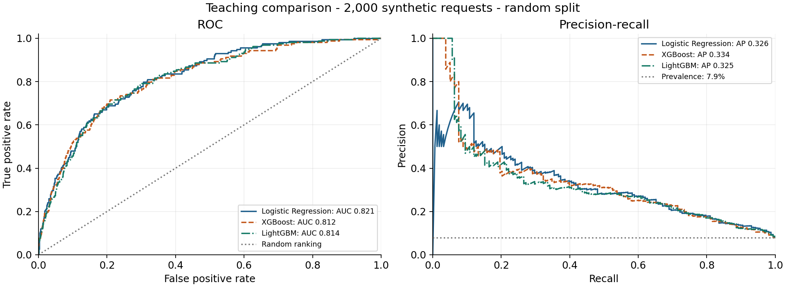
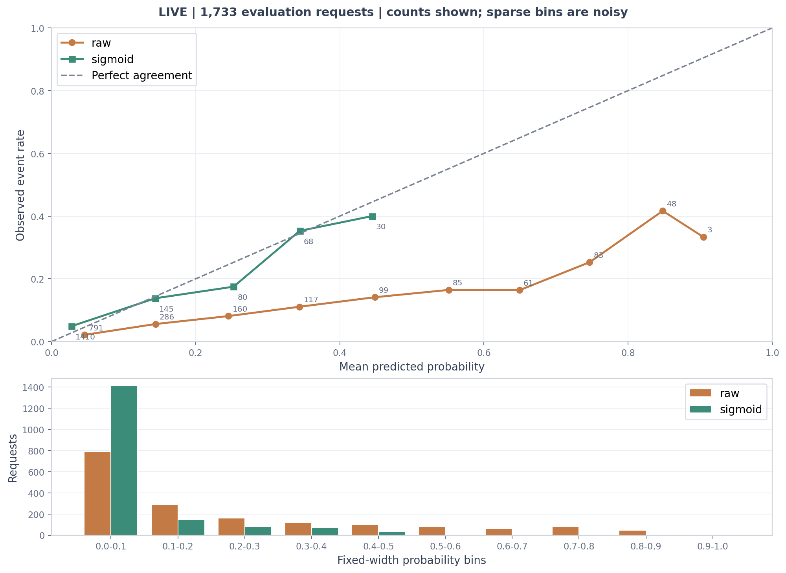

# Tamweel | SDAIA

Credit-risk modeling project for SDA-DSC-211. The objective is to predict whether a synthetic loan applicant defaults within 90 days of applying (`default_within_90d`), using only information available at application time.

All records are synthetic. The results are educational and do not constitute evidence for real-world lending or deployment.

## Repository Structure

```text
README.md
notebooks/
  01_baseline_boosting.ipynb
  02_validation_tuning.ipynb
  03_cost_sensitive_decision.ipynb
  04_explain_calibrate.ipynb
  05_final_model.ipynb
artifacts/
  day1_artifacts/
  day2_artifacts/
  day3_artifacts/
  day4_artifacts/
  ensemble_comparison.csv
  final_metrics.json
  final_policy.json
  final_model/
reports/
  ENSEMBLE_DECISION.md
  MODEL_CARD.md
submission/
  submission.csv
  submission_manifest.json
```

## Results at a Glance

| Day | Topic | Headline Result |
|---|---|---|
| 1 | Baseline vs. boosting | ROC-AUC ranged from 0.812 to 0.821; no statistically significant winner. |
| 2 | Honest validation | AP dropped from 0.9988 under leaky validation to 0.315 under honest fixed validation. |
| 3 | Cost-sensitive decision | Capacity-safe threshold: 0.658347; 526 flags out of 5,039 OOF requests. |
| 4 | Explanation and calibration | `bureau_score` was the leading feature; Brier improved from 0.1130 to 0.0671. |
| 5 | Final model | KEEP SINGLE: Logistic Regression, mean AP 0.392; 300 final review flags out of 2,500 requests. |

## Day 1: Baseline vs. Boosting

Three models were trained and compared using the same development and comparison split.

| Model | ROC-AUC | Average Precision | Train Time | Trees |
|---|---:|---:|---:|---:|
| Logistic Regression | 0.821 | 0.326 | 0.04 s | - |
| XGBoost | 0.812 | 0.334 | 0.38 s | 61 |
| LightGBM | 0.814 | 0.325 | 0.24 s | 41 |



The comparison used 2,000 untouched rows. The paired bootstrap showed that the performance differences between the three models were within noise. LightGBM was selected as a practical initial candidate because it trained faster than XGBoost, not because it was proven to be the best model.

**Limitation:** The split was random and stratified. It did not account for time ordering, and 1,226 customers appeared on both sides of the split. This was a teaching baseline, not a reliable estimate of future performance.

## Day 2: Honest Validation and Tuning

The feature audit identified two post-application variables that could leak information about the outcome:

- `days_past_due_60`
- `collection_calls`

Both were removed before the honest validation experiments.

| Protocol | ROC-AUC | Average Precision | Rows Scored |
|---|---:|---:|---:|
| Leaky random control (unsafe) | 0.9999 | 0.9988 | 10,000 |
| Clean random control (unsafe) | 0.801 | 0.311 | 10,000 |
| Honest, fixed 80 trees | 0.798 | 0.315 | 5,039 |
| Honest, reserved search | 0.786 | 0.313 | 5,039 |


The honest design used three forward, time-ordered folds. Training labels had to be mature (application date + 90 days < validation start), and validation customers were removed from their corresponding training folds. Imputation was learned using training data only.

Hyperparameter tuning was performed on a separate older cohort before reading the outer validation results.

The results demonstrate the impact of leakage: AP fell from 0.9988 in the leaky control to 0.315 under honest fixed validation.

**Limitations:** Out-of-fold predictions covered 5,039 requests (50.39% of the data); 4,961 warm-up rows had no prediction. The folds are related and do not represent an independent final test. Tuning did not improve AP over the fixed model (0.313 vs. 0.315).

## Day 3: Cost-Sensitive Decision

The decision policy assigns a cost of 10 teaching units to a missed default (FN) and 1 teaching unit to a false alarm (FP). Each validation period has a maximum review capacity of 12%.

The analysis used a class-weighted LightGBM model and 5,039 out-of-fold requests.

| Rule | Threshold | Flagged | Recall | Precision | Loss (Units) | Within Capacity |
|---|---:|---:|---:|---:|---:|:---:|
| Default 0.5 | 0.5000 | 1,005 (19.9%) | 57.8% | 22.1% | 2,403 | No |
| Min. loss, no capacity limit | 0.4486 | 1,141 (22.6%) | 64.1% | 21.6% | 2,275 | No |
| Min. loss, every period ≤ 12% | 0.658347 | 526 (10.4%) | 40.9% | 29.9% | 2,639 | Yes |


The default 0.5 threshold exceeded the review capacity. The unconstrained minimum-loss threshold reduced the estimated loss but increased the review volume further.

The capacity-safe threshold of 0.658347 was selected because it kept every validation period within the 12% limit. It produced 526 flags (10.4%), with 40.89% recall and 29.85% precision.

Its loss was 236 teaching units higher than the default 0.5 threshold. This reflects the trade-off between minimizing estimated loss and respecting the operational capacity constraint.

A review flag means that a request should be sent for further review. It does not mean automatic approval or rejection.

**Limitations:** The threshold and its estimated loss were evaluated on the same out-of-fold outcomes used during development. Loss is measured in teaching units, not actual monetary costs. The results are development evidence, not a final independent test.

## Day 4: Explanation and Calibration

The explanation analysis used a class-weighted LightGBM model with 80 trees.

| Evidence | Value |
|---|---|
| Top feature by mean absolute SHAP | `bureau_score`: 0.9042 log-odds |
| Second feature by mean absolute SHAP | `dti`: 0.5437 log-odds |
| Largest held-out AP drop when shuffled | `bureau_score`: 0.1270 |
| Brier score, raw → sigmoid | 0.1130 → 0.0671 |
| ECE, raw → sigmoid | 0.1469 → 0.0225 |
| Review status | `CAPACITY_REVIEW_REQUIRED` |



`bureau_score` was the most influential feature in the model's explanations. It had the largest mean absolute SHAP value and the largest held-out Average Precision drop when shuffled.

These results describe model behavior, not causation. SHAP and permutation importance show how the model relies on features when ranking requests; they do not establish what would happen if a feature were changed. Correlated features may share importance, and a feature may act as a proxy for other underlying factors.

### Calibration Results

Calibration was evaluated on 1,733 evaluation rows, including 139 positive cases.

| Metric | Raw | Sigmoid |
|---|---:|---:|
| Brier | 0.113027 | 0.067112 |
| ECE | 0.146871 | 0.022486 |
| Average Precision | 0.258677 | 0.258677 |
| ROC-AUC | 0.770804 | 0.770804 |

The sigmoid improved the Brier score and ECE without changing Average Precision or ROC-AUC because the mapping was monotonic.

**Limitations:** The evaluation period had been seen earlier in the course, so it was not an untouched final test. The review status remained `CAPACITY_REVIEW_REQUIRED`: the evaluation quarters exceeded the 12% capacity requirement. Calibration and capacity results should therefore be interpreted as development evidence rather than deployment approval.

## Day 5: Final Model and Delivery

The final comparison evaluated three individual models, equal averaging, weighted averaging, and stacking across three forward validation folds: 2023Q1, 2023Q3, and 2024Q1.

An ensemble was accepted only if its AP improvement exceeded the best single model's fold standard deviation (approximately 0.030), without worsening Brier or ECE beyond the defined tolerances.

| Candidate | Mean AP | Fold SD | Brier | ECE | AP Change vs. Best Single |
|---|---:|---:|---:|---:|---:|
| Logistic Regression | 0.392 | 0.030 | 0.0633 | 0.0188 | 0 |
| LightGBM | 0.345 | 0.043 | 0.0661 | 0.0231 | -0.046 |
| XGBoost | 0.353 | 0.029 | 0.0657 | 0.0228 | -0.039 |
| Equal Average | 0.372 | 0.033 | 0.0643 | 0.0204 | -0.020 |
| Weighted Average | 0.389 | 0.029 | 0.0633 | 0.0177 | -0.002 |
| Stacking | 0.383 | 0.029 | 0.0660 | 0.0311 | -0.009 |

**Decision: KEEP SINGLE — Logistic Regression.**

Logistic Regression achieved the highest mean Average Precision (0.3917). None of the ensemble approaches achieved the required improvement of more than 0.030. Weighted averaging had a slightly lower ECE, but its AP remained below the single model and its improvement was insufficient to justify the added complexity.

The final decision was therefore to retain Logistic Regression as the single model. It is simpler to refit, explain, and monitor.

### Final Calibration

The final model's sigmoid calibrator was fitted on a reserved period from July to September 2024 (836 rows, including 78 positive cases).

Its diagnostics were evaluated on those same rows, so they are fit diagnostics rather than independent evidence.

| Metric | Raw | Sigmoid |
|---|---:|---:|
| Brier | 0.0765 | 0.0781 |
| ECE | 0.0211 | 0.0349 |
| Average Precision | 0.2878 | 0.2878 |
| ROC-AUC | 0.7890 | 0.7890 |

The sigmoid did not improve calibration on this sample. The ranking remained unchanged, and the raw logistic scores were already reasonably calibrated on these diagnostic rows. With only 78 positive cases, the estimate is noisy.

These Day 5 calibration results are separate from Day 4's calibration results, which belong to a different class-weighted LightGBM model.

### Challenge Batch and Capacity

The challenge batch contained 2,500 requests. The transported threshold was 0.122258.

| Evidence | Value |
|---|---:|
| Challenge requests | 2,500 |
| Review capacity | 300 |
| Requests above threshold | 330 |
| Final review flags | 300 |
| Requests removed by capacity cap | 30 |
| Boundary score | 0.129908 |

The threshold first identified 330 eligible requests. The full-batch capacity rule then retained 300 requests and removed 30. Equal-score blocks were not split.

The final submission contains 2,500 rows with simulated review decisions. Since challenge labels are unavailable, no challenge AP, loss, or false-positive rate is claimed.

**Limitations:** The three forward folds have overlapping training histories, so the fold standard deviation is descriptive rather than a confidence interval. The training data was reused throughout the course, so the results are not from an untouched final test. Day 4 explanations belong to a different model and do not automatically transfer to the final Logistic Regression model.

## Daily Answers | الإجابات اليومية

### Day 1

**Initial candidate:** LightGBM.

**Strongest evidence:** On the 2,000 untouched comparison rows, LightGBM achieved ROC-AUC of 0.814 and Average Precision of 0.325. It also trained faster than XGBoost (0.24 seconds versus 0.38 seconds) using 41 trees. However, the paired bootstrap showed no significant difference between the three models, so LightGBM was a practical initial choice rather than a proven winner.

**Limitation and next step:** The evaluation used one random split, with 1,226 customers appearing on both sides, and did not account for time ordering. Day 2 addressed this limitation using customer-grouped, time-ordered validation.

### Day 2

**Leakage risk:** `days_past_due_60` and `collection_calls` are recorded only after application, making them unavailable at prediction time. Including them inflated AP to 0.9988, compared with 0.311 after removing the leakage.

**How the validation design prevented it:** I removed both variables and checked for duplicate events, finding none. I then used three time-ordered folds with a label-maturity rule (application date + 90 days < validation start). Validation customers were excluded from training, with zero shared customers. Imputation was learned using training data only, and hyperparameter tuning was performed on a separate older cohort before evaluating the outer folds.

**Limitations:** The evaluation covered 5,039 out-of-fold rows (50.39% coverage) across a small number of related folds. Tuning did not improve AP (0.313 compared with 0.315 for the fixed model). These results are not an independent final test.

### Day 3

**Why is a fixed threshold of 0.5 not always suitable for this review policy?**

A fixed threshold of 0.5 ignores the operational and cost constraints of the review policy. A missed default costs 10 times as much as a false alarm, only about 7.6% of requests are defaults, and the model is class-weighted, meaning its raw scores should not automatically be treated as calibrated probabilities. Most importantly, each period may flag no more than 12% of requests.

At 0.5, the model flagged 1,005 requests (19.9%), and its busiest period exceeded the capacity limit. The unconstrained loss-minimizing threshold of 0.448639 reduced estimated loss to 2,275 teaching units but increased the flagged share to 22.6%.

The capacity-safe threshold of 0.658347 produced 526 flags (10.4%), with 40.89% recall, 29.85% precision, and a loss of 2,639 units. This is 236 units higher than the default threshold's loss, but it is the option that respects the capacity constraint across all validation periods.

Therefore, the threshold should be selected based on the actual cost and capacity policy rather than relying on the default value of 0.5.

**Limitations:** The threshold and its estimated loss were evaluated using the same out-of-fold outcomes used during development. The loss is expressed in teaching units, not actual monetary costs, and a flag represents a request for review rather than automatic rejection.

### Day 4

**Which feature was most important in your explanation, and why does that not prove causation?**

`bureau_score` was the most important feature in the model's explanations. It had the largest mean absolute SHAP value (0.9042 log-odds, compared with 0.5437 for `dti`) and the largest held-out Average Precision drop when shuffled (0.1270). It was also the top contribution (+2.2693 log-odds) for the highest-scoring request in the SHAP sample.

This does not prove causation because SHAP and permutation importance describe which features the model relies on when ranking requests. They do not establish what would happen if a person's bureau score were changed. Correlated features can share importance, and `bureau_score` may represent other underlying factors. A model trained on observed associations cannot distinguish causal relationships from correlations.

SHAP explains the raw class-weighted model score in log-odds, not the calibrated probability.

**Calibration and limitations:** Sigmoid calibration improved Brier from 0.113027 to 0.067112 and ECE from 0.146871 to 0.022486 on 1,733 evaluation rows, including 139 positive cases. However, the evaluation period had been seen earlier in the course and was not an untouched final test. The review status remained `CAPACITY_REVIEW_REQUIRED`, so the capacity requirement was not fully satisfied.

### Day 5

**Why did you choose the single model or the ensemble for the final project?**

I kept a single model, Logistic Regression, because none of the ensemble approaches demonstrated enough improvement to justify their additional complexity. Across the three forward validation folds, Logistic Regression achieved the highest mean Average Precision (0.3917, with a fold SD of 0.0298), ahead of XGBoost (0.3526) and LightGBM (0.3455).

Equal averaging achieved 0.3717, weighted averaging achieved 0.3894, and stacking achieved 0.3831. None exceeded the required improvement of more than 0.030 over the best single model. Although weighted averaging had a slightly lower ECE than Logistic Regression, its AP was still lower and did not meet the acceptance rule.

The decision gate therefore returned `KEEP SINGLE`. A single Logistic Regression model is also simpler to refit, explain, and monitor. The ensemble weights and stacker were learned using inner out-of-fold data, with customers separated and labels mature.

**Calibration:** The sigmoid calibrator was evaluated on the same 836 rows used to fit it, including 78 positive cases. Brier increased from 0.0765 to 0.0781 and ECE increased from 0.0211 to 0.0349. Therefore, no calibration improvement is claimed.

**Limitations:** The three forward folds cover overlapping periods, so the fold standard deviation is descriptive rather than a confidence interval. The training data was reused throughout the course, meaning the results are not from an untouched final test. Day 4 explanations belong to a different model (class-weighted LightGBM) and must not be attributed to the final Logistic Regression model. Finally, challenge labels are unavailable, so no challenge performance or fairness claim is made.
