# Tamweel | Credit Risk Analytics

<p align="center">
  <strong>From baseline modelling to a capacity-aware final decision</strong><br>
  SDA-DSC-211 · Synthetic credit-risk prediction · Seed 211
</p>

<p align="center">
  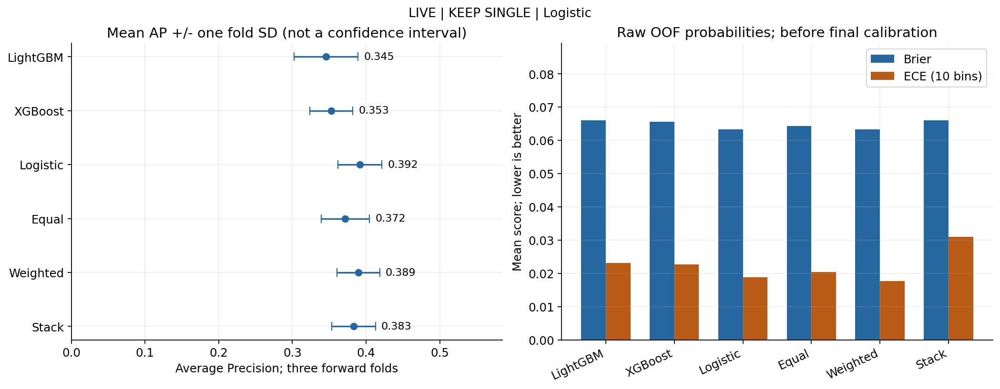
</p>

<p align="center">
  <em>A five-day project covering model selection, leakage-safe validation, cost-sensitive decisions, model interpretation, calibration, and final delivery.</em>
</p>

> **Project scope:** predict whether a synthetic applicant defaults within 90 days of applying (`default_within_90d`), using information available at application time. All data are synthetic. This is a learning project, not a credit decision system and not evidence of production readiness.

## Project at a glance

| Stage | Focus | Main finding |
|---|---|---|
| Day 1 | Baselines and boosting | Three models performed similarly; LightGBM was a practical initial candidate, not a statistically proven winner. |
| Day 2 | Leakage and validation | Removing post-application leakage reduced AP from 0.9988 to about 0.31 under honest evaluation. |
| Day 3 | Cost and capacity policy | A threshold of 0.6583 respected the 12% per-period review cap; the default 0.5 threshold did not. |
| Day 4 | Explanation and calibration | `bureau_score` was the strongest model signal; sigmoid calibration improved the Day 4 evaluation metrics. |
| Day 5 | Final selection and delivery | **KEEP SINGLE — Logistic Regression.** No ensemble met the required AP improvement. The challenge batch ended with 300 flags out of 2,500. |

## Contents

- [Project workflow](#project-workflow)
- [Results and evidence](#results-and-evidence)
- [Day 1 — Baseline comparison](#day-1--baseline-comparison)
- [Day 2 — Honest validation](#day-2--honest-validation)
- [Day 3 — Cost-sensitive decision](#day-3--cost-sensitive-decision)
- [Day 4 — Explanation and calibration](#day-4--explanation-and-calibration)
- [Day 5 — Final model and challenge batch](#day-5--final-model-and-challenge-batch)
- [Daily answers](#daily-answers)
- [Reproducibility](#reproducibility)
- [Limitations](#limitations)
- [Key project documents](#key-project-documents)
- [Repository structure](#repository-structure)
- [Acknowledgements](#acknowledgements)

## Project workflow

The work follows five connected stages:

1. Establish a baseline and compare candidate models.
2. remove leakage and replace random evaluation with time-ordered, customer-separated validation.
3. choose an operating threshold using the stated error costs and review-capacity constraint.
4. inspect the Day 4 model's explanations and calibration behaviour.
5. compare single models with ensemble candidates, select the final model, and apply the batch-level capacity rule.

The notebooks contain the analysis and implementation. The artifacts and reports provide supporting evidence for the reported results.

## Results and evidence

### Day 1 — Baseline comparison

| Model | ROC-AUC | Average Precision | Training time | Trees |
|---|---:|---:|---:|---:|
| Logistic Regression | 0.821 | 0.326 | 0.04 s | — |
| XGBoost | 0.812 | 0.334 | 0.38 s | 61 |
| LightGBM | 0.814 | 0.325 | 0.24 s | 41 |

The comparison used 2,000 untouched rows. Paired bootstrap results did not show a clear statistically significant difference between the three models. LightGBM was retained as a practical initial candidate because it trained faster than XGBoost; it was not established as the best-performing model.

<p align="center">
  
</p>

<p align="center">
  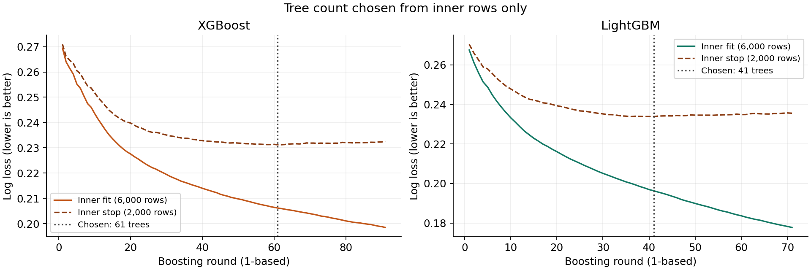
</p>

### Day 2 — Honest validation

| Validation protocol | ROC-AUC | Average Precision | Rows |
|---|---:|---:|---:|
| Leaky random — unsafe | 0.9999 | 0.9988 | 10,000 |
| Clean random — unsafe | 0.801 | 0.311 | 10,000 |
| Honest, fixed 80 trees | 0.798 | 0.315 | 5,039 |
| Honest, reserved search | 0.786 | 0.313 | 5,039 |

Two post-application fields, `days_past_due_60` and `collection_calls`, were removed because they would not be available at application time. The honest evaluation used three time-ordered folds, a 90-day label-maturity rule, customer separation between training and validation, and imputation fitted on training data only.

The honest out-of-fold predictions covered 5,039 rows (50.39%). Reserved search did not improve AP over the fixed 80-tree result (0.313 vs. 0.315).

<p align="center">
  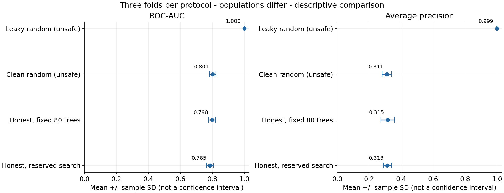
</p>

<p align="center">
  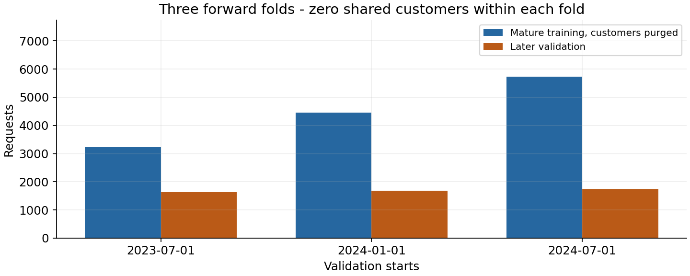
</p>

<p align="center">
  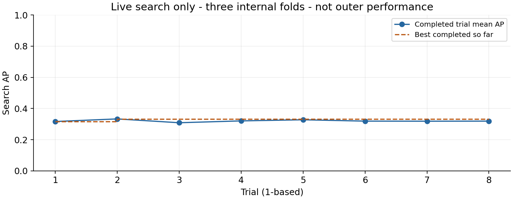
</p>

### Day 3 — Cost-sensitive decision

The review policy assigns 10 teaching units to a false negative and 1 unit to a false positive. No validation period may flag more than 12% of requests. The results below use 5,039 out-of-fold predictions from the class-weighted LightGBM model.

| Decision rule | Threshold | Flagged | Recall | Precision | Loss (teaching units) | Capacity |
|---|---:|---:|---:|---:|---:|:---:|
| Default threshold | 0.5000 | 1,005 (19.9%) | 57.8% | 22.1% | 2,403 | Exceeded |
| Minimum loss, no cap | 0.4486 | 1,141 (22.6%) | 64.1% | 21.6% | 2,275 | Exceeded |
| Minimum loss within every-period cap | 0.6583 | 526 (10.4%) | 40.9% | 29.9% | 2,639 | Respected |

The capacity-safe rule costs 236 more teaching units than the default threshold, but it is the only one of these operating points that respects the 12% limit in every period. A review flag means “send for review”; it does not mean reject an applicant.

<p align="center">
  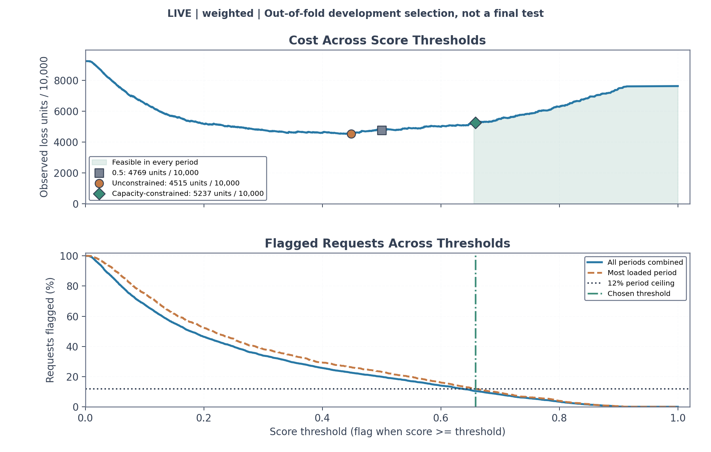
</p>

<p align="center">
  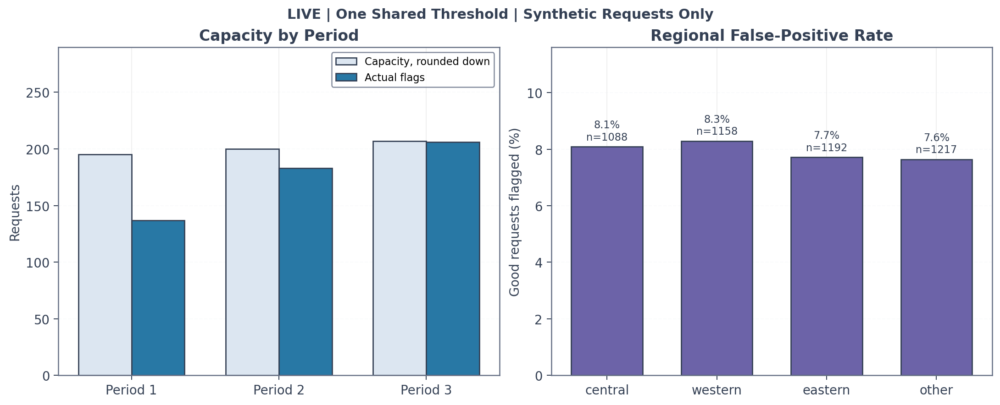
</p>

<p align="center">
  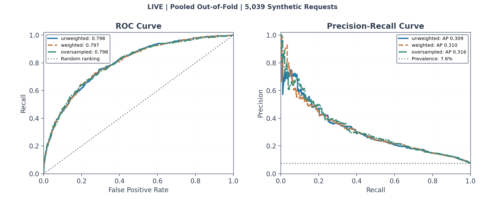
</p>

### Day 4 — Explanation and calibration

Day 4 explanations refer to the **class-weighted LightGBM model**, not the final Day 5 Logistic Regression model.

| Evidence | Result |
|---|---:|
| Mean absolute SHAP — `bureau_score` | 0.904 log-odds |
| Mean absolute SHAP — `dti` | 0.544 log-odds |
| Held-out AP drop after shuffling `bureau_score` | 0.127 |
| Held-out AP drop after shuffling `dti` | 0.069 |
| Brier, raw → sigmoid | 0.1130 → 0.0671 |
| ECE, raw → sigmoid | 0.1469 → 0.0225 |
| Review status | `CAPACITY_REVIEW_REQUIRED` |

The calibration evaluation contained 1,733 rows and 139 positive cases. AP and ROC-AUC remained unchanged after sigmoid calibration, while Brier score and ECE improved. The review zone still exceeded the 12% capacity in evaluation quarters, so the review status remains an important finding rather than a success claim.

<p align="center">
  
</p>

<p align="center">
  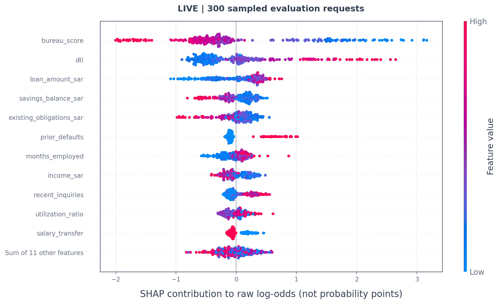
</p>

<p align="center">
  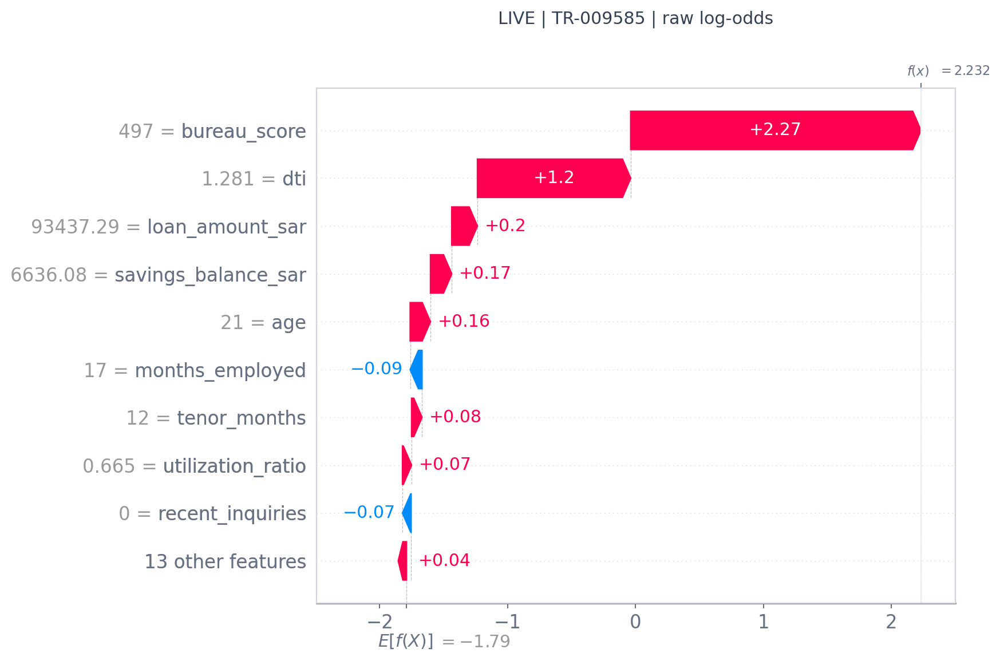
</p>

<p align="center">
  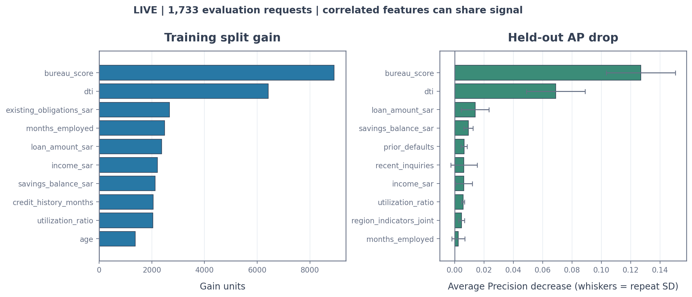
</p>

<p align="center">
  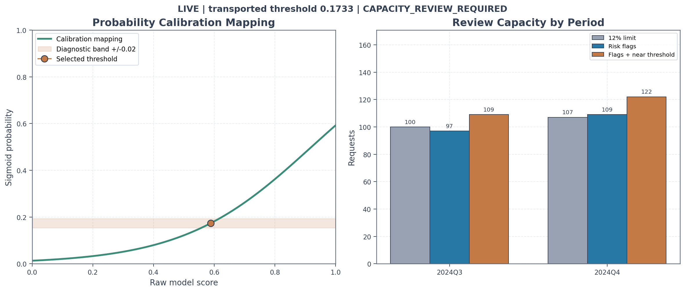
</p>

### Day 5 — Final model and challenge batch

The final comparison used three forward folds: 2023Q1, 2023Q3 and 2024Q1. The reference fold standard deviation for the best single model's AP was 0.0298. An ensemble had to improve AP by more than this reference and stay within the gate tolerances: Brier increase no greater than 0.005 and ECE increase no greater than 0.01.

| Candidate | Mean AP | Fold SD | Brier | ECE | AP change vs. Logistic |
|---|---:|---:|---:|---:|---:|
| Logistic Regression | 0.3917 | 0.0298 | 0.0633 | 0.0188 | 0.0000 |
| LightGBM | 0.3455 | 0.0435 | 0.0661 | 0.0231 | -0.0462 |
| XGBoost | 0.3526 | 0.0290 | 0.0657 | 0.0228 | -0.0390 |
| Equal average | 0.3717 | 0.0326 | 0.0643 | 0.0204 | -0.0200 |
| Weighted average | 0.3894 | 0.0291 | 0.0633 | 0.0177 | -0.0022 |
| Stacking | 0.3831 | 0.0295 | 0.0660 | 0.0311 | -0.0085 |

**Decision: KEEP SINGLE — Logistic Regression.** No ensemble achieved the required AP lift. Weighted averaging had a slightly lower ECE, but its AP was lower than Logistic Regression and the improvement was not enough to justify the added complexity.

The final sigmoid calibration diagnostics were calculated on the same 836 rows (78 positives) used to fit the calibrator. In those fit diagnostics, Brier changed from 0.0765 to 0.0781 and ECE from 0.0211 to 0.0349; both worsened. AP (0.2878) and ROC-AUC (0.7890) were unchanged. These are not independent calibration results.

For the 2,500-request challenge batch, 330 requests passed the transported threshold (0.122258). The 12% batch cap retained 300 flags and removed 30. The boundary score was 0.129908, and equal-score blocks were not split. Challenge labels were unavailable, so no challenge AP, loss, FPR, or fairness performance is claimed.

<p align="center">
  
</p>

<p align="center">
  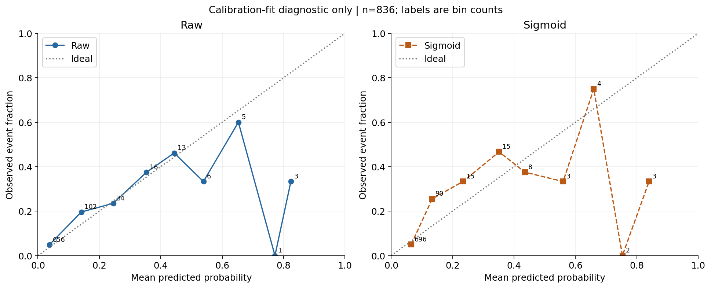
</p>

<p align="center">
  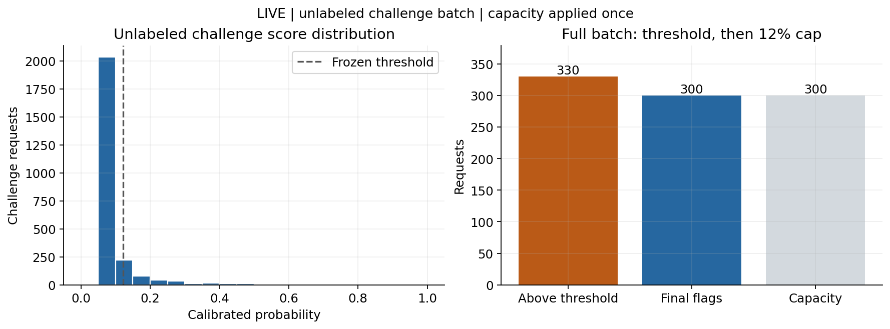
</p>

<p align="center">
  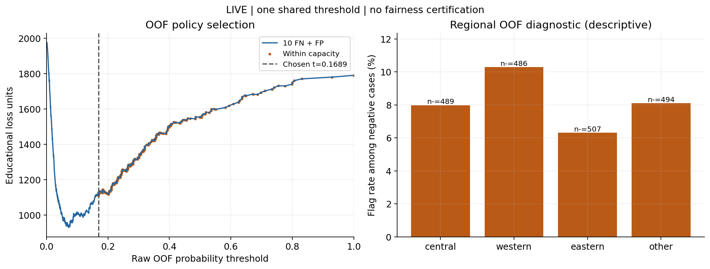
</p>

## Daily answers

### Day 1 — Why was LightGBM selected as the initial candidate?

LightGBM was a practical starting point because it trained faster than XGBoost (0.24 s vs. 0.38 s) while reaching a similar ROC-AUC (0.814). The paired bootstrap did not establish a clear statistical winner among the three models. The initial split also had limitations: 1,226 customers appeared on both sides and the split was not time-ordered. Day 2 therefore moved to customer-separated, time-ordered validation.

### Day 2 — What caused leakage, and how was it addressed?

The fields `days_past_due_60` and `collection_calls` describe events after application and would not be available at prediction time. They inflated the leaky random AP to 0.9988. Both were removed. The revised design used time-ordered folds, 90-day label maturity, no shared validation customers in training, and training-only imputation. The honest evaluation covered 5,039 out-of-fold rows; reserved tuning did not improve AP over the fixed model.

### Day 3 — Why is a fixed threshold of 0.5 not always suitable?

A fixed threshold does not account for the asymmetric error costs or the review-capacity limit. At 0.5, 1,005 requests were flagged (19.9%), and the busiest period reached 23.2%, exceeding the 12% cap. The unconstrained minimum-loss threshold flagged even more requests. The threshold 0.6583 respected the cap in every period, with 526 flags (10.4%), recall of 40.9%, precision of 29.9%, and loss of 2,639 teaching units. The threshold and loss were estimated on the same OOF outcomes, so this is a development result rather than a final independent test.

### Day 4 — Which feature mattered most, and does that establish causation?

`bureau_score` was the strongest model signal: it had the largest mean absolute SHAP value (0.904 log-odds), the largest held-out AP drop after permutation (0.127), and a +2.27 log-odds contribution in the highest-scoring case explained. These methods describe how the model uses features; they do not show that changing a feature would cause a change in default risk. Correlated variables can share importance, and SHAP here explains the raw class-weighted LightGBM score in log-odds, not the calibrated probability.

### Day 5 — Why keep a single model instead of an ensemble?

Logistic Regression had the best mean AP across the three forward folds (0.3917). Equal averaging, weighted averaging and stacking all had lower AP, and none met the required improvement of more than the 0.0298 reference fold SD. The decision was therefore **KEEP SINGLE**. The three fold histories overlap, so fold SD is descriptive rather than a confidence interval, and the training data was reused during the course; this is not an untouched final test.

## Reproducibility

- Open the notebooks in Google Colab using a free CPU runtime.
- Run each notebook from top to bottom. The notebooks use seed 211.
- The first setup cell may install pinned packages and restart the runtime; if Colab displays a session-restart notice, run the notebook again.
- Small last-decimal and execution-time differences can occur across environments.
- See the Day 5 project bundle under `submission/project_bundle/` for the final model, policy, reports, scripts and delivery evidence.

## Limitations

- All data are synthetic and do not represent real applicants, lenders, or regions.
- This work is for education and review only. It must not be used to approve, reject, price, or otherwise make real financing decisions.
- Day 1 used a random split with customer overlap; Day 2 onward addressed this with time-ordered, customer-separated validation.
- The Day 3 threshold and loss were selected and evaluated on the same OOF outcomes.
- Day 4 explanations belong to class-weighted LightGBM. They do not transfer to the final Day 5 Logistic Regression model.
- Day 5 sigmoid metrics are fit diagnostics on the calibrator's own 836 fitting rows, not independent evidence.
- The three Day 5 forward folds have overlapping training histories; their standard deviation is descriptive, not a confidence interval.
- Challenge labels are unavailable. No challenge-set predictive performance or fairness claim is made.
- A review flag means further review, not automatic rejection.

## Key project documents

- [Interpretability Report](reports/INTERPRETABILITY_REPORT.md) — Day 4 model explanations, calibration, stability, and review-capacity diagnostics.
- [Ensemble Decision](reports/ENSEMBLE_DECISION.md) — final comparison and the KEEP SINGLE decision.
- [Model Card](reports/MODEL_CARD.md) — intended use, validation, limitations, and monitoring.
- [Final presentation (PDF)](submission/project_bundle/presentation/final_presentation.pdf) — five-slide project presentation.
- [Presentation guide](submission/project_bundle/presentation/FINAL_PRESENTATION_GUIDE.md) — assessment criteria and presentation guidance.
- [Five-slide presentation template](submission/project_bundle/presentation/FINAL_PRESENTATION_TEMPLATE.md) — editable outline for preparing the presentation.

## Repository structure

This project follows a five-day workflow focused on building and evaluating a credit risk model, from baseline model development to final model selection and decision-making.

The repository is organized to provide access to the analysis notebooks, datasets, supporting scripts, model artifacts, evaluation results, and documentation needed to understand and reproduce the project.

```text
.
├── README.md
├── requirements-colab.txt
├── constraints.txt
├── data/
│   ├── data_contract.json
│   ├── data_manifest.json
│   ├── tamweel_train.csv
│   └── tamweel_challenge.csv
├── notebooks/
│   ├── 01_baseline_boosting.ipynb
│   ├── 02_validation_tuning.ipynb
│   ├── 03_cost_sensitive_decision.ipynb
│   ├── 04_explain_calibrate.ipynb
│   ├── 05_final_model.ipynb
│   └── 99_final_submission_check.ipynb
├── tamweel/
│   ├── __init__.py
│   └── inference.py
├── scripts/
│   ├── inference.py
│   └── rebuild_final.py
├── artifacts/
│   ├── final_model/
│   ├── day5_run.json
│   ├── ensemble_comparison.csv
│   ├── final_metrics.json
│   └── final_policy.json
├── reports/
│   ├── INTERPRETABILITY_REPORT.md
│   ├── ENSEMBLE_DECISION.md
│   └── MODEL_CARD.md
└── submission/
    ├── submission.csv
    ├── submission_manifest.json
    └── project_bundle/
        ├── PROJECT_README.md
        ├── requirements-colab.txt
        ├── constraints.txt
        ├── data/
        ├── evidence/
        │   ├── day1/
        │   ├── day2/
        │   ├── day3/
        │   └── day4/
        ├── notebooks/
        ├── artifacts/
        ├── reports/
        ├── scripts/
        ├── presentation/
        │   ├── final_presentation.pdf
        │   ├── FINAL_PRESENTATION_GUIDE.md
        │   └── FINAL_PRESENTATION_TEMPLATE.md
        └── submission/
```

- **notebooks/** — the five main analysis notebooks, from baseline modelling through final model selection.
- **tamweel/** — reusable inference code available at the repository root.
- **artifacts/** — the final model, model manifest, evaluation metrics, policy, and ensemble comparison.
- **reports/** — the interpretability report, model card, and final ensemble decision.
- **submission/** — the challenge predictions, their manifest, and the complete project bundle.
- **submission/project_bundle/** — the reproducibility package, including data contracts and datasets, Day 1–Day 4 evidence, supporting scripts, reports, notebooks, and presentation files.

## Acknowledgements

This project was completed as part of the SDA-DSC-211 learning programme at SDAIA Academy. Visit the [SDAIA Academy GitHub organization](https://github.com/SDAIAAcademy) for its public learning resources.

## Project status

**Final model selection: KEEP SINGLE — Logistic Regression.**

The repository documents the five-day workflow, its evidence, and its limitations. The results support a course-project decision, not deployment or real-world credit use.
