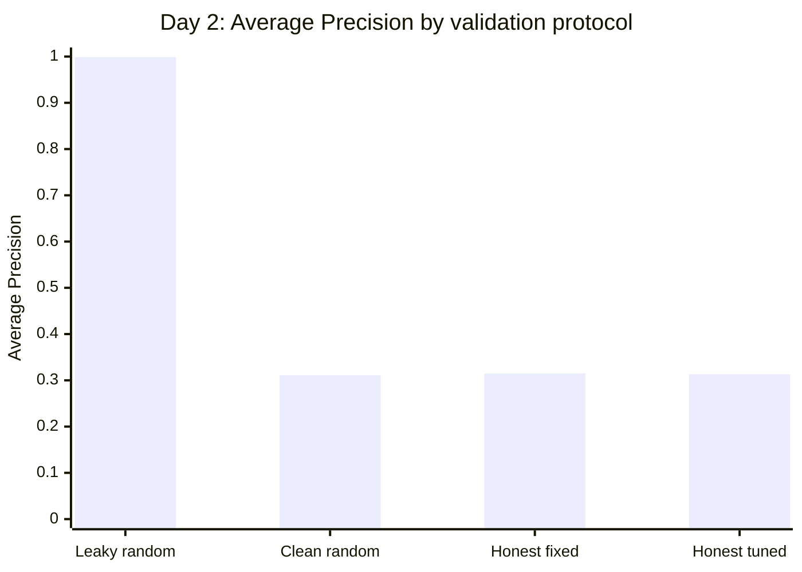
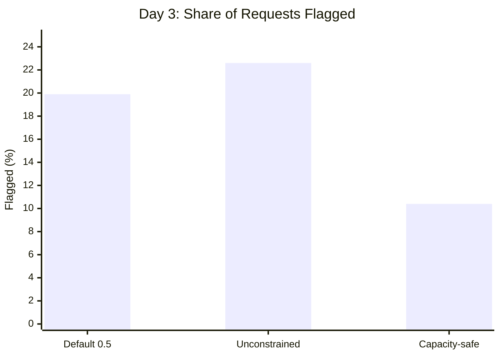

# Tamweel | SDAIA

Credit-risk project: predict whether a synthetic applicant defaults within 90 days of applying (`default_within_90d`) using only information available at application time. All data is synthetic; results are educational and do not constitute deployment evidence.

## Repository Structure

```text
README.md
notebooks/
  01_baseline_boosting.ipynb        Day 1: Model comparison
  02_validation_tuning.ipynb        Day 2: Honest validation and tuning
  03_cost_sensitive_decision.ipynb  Day 3: Cost-sensitive threshold
  04_explain_calibrate.ipynb        Day 4: Explanation and calibration
  05_final_model.ipynb              Day 5: Final model and delivery
artifacts/                          Evidence files (CSV, JSON, PNG)
reports/                            Decision card, interpretability report, model card
submission/                         Submission predictions and project bundle
```

## Results at a Glance

| Day | Topic | Headline Result |
|---|---|---|
| 1 | Baseline vs. boosting | ROC-AUC ranged from 0.812 to 0.821 across the three models; differences were within the observed uncertainty. |
| 2 | Honest validation | Average Precision dropped from 0.9988 under leaky validation to 0.311 after removing leakage. |
| 3 | Decision threshold | The default 0.5 threshold exceeded the 12% review capacity; the capacity-safe threshold was 0.6583. |
| 4 | Explanation and calibration | `bureau_score` was the leading feature. Brier improved from 0.1130 to 0.0671 after sigmoid calibration, with evaluation limitations noted below. |
| 5 | Final model | KEEP SINGLE: Logistic Regression (mean AP 0.392); 300 final review flags out of 2,500 requests. |



## Day 1: Baseline vs. Boosting

Three models were compared on the same untouched comparison set.

| Model | ROC-AUC | AP | Train Time | Trees |
|---|---:|---:|---:|---:|
| Logistic Regression | 0.821 | 0.326 | 0.04 s | - |
| XGBoost | 0.812 | 0.334 | 0.38 s | 61 |
| LightGBM | 0.814 | 0.325 | 0.24 s | 41 |


Logistic Regression achieved the highest ROC-AUC, while XGBoost had the highest Average Precision. The paired bootstrap showed no significant difference between the three models, so none was established as a clear winner. LightGBM was selected as a practical initial candidate because it trained faster than XGBoost.

## Day 2: Honest Validation and Tuning

The initial validation results revealed substantial leakage risk. Two variables, `days_past_due_60` and `collection_calls`, are recorded after application and therefore cannot be used as predictors at application time.

| Protocol | ROC-AUC | AP | Rows Scored |
|---|---:|---:|---:|
| Leaky random (unsafe) | 0.9999 | 0.9988 | 10,000 |
| Clean random (unsafe) | 0.801 | 0.311 | 10,000 |
| Honest, fixed 80 trees | 0.798 | 0.315 | 5,039 |
| Honest, reserved search | 0.786 | 0.313 | 5,039 |


The clean validation design removed post-application variables, checked for duplicate events, and used three time-ordered folds with a 90-day label-maturity rule. Validation customers were excluded from training, imputation was fitted on training data only, and hyperparameter tuning used a separate older cohort.

The results show why validation design matters: the apparent AP of 0.9988 under the leaky setup fell to approximately 0.31 under leakage-aware evaluation.

## Day 3: Cost-Sensitive Decision

The decision policy assigns a cost of 10 teaching units to a missed default (FN) and 1 unit to a false alarm (FP). In addition, no validation period may flag more than 12% of requests for review.

The analysis used a class-weighted LightGBM model and 5,039 out-of-fold requests.

| Rule | Threshold | Flagged | Recall | Precision | Loss (Units) | Within Capacity |
|---|---:|---:|---:|---:|---:|:---:|
| Default 0.5 | 0.5000 | 1,005 (19.9%) | 57.8% | 22.1% | 2,403 | No |
| Min. loss, no capacity limit | 0.4486 | 1,141 (22.6%) | 64.1% | 21.6% | 2,275 | No |
| Min. loss, every period ≤ 12% | 0.6583 | 526 (10.4%) | 40.9% | 29.9% | 2,639 | Yes |




The default 0.5 threshold exceeded the review capacity, flagging 19.9% of requests. The unconstrained minimum-loss threshold reduced the estimated loss but increased the review volume further.

The capacity-safe threshold of 0.6583 was selected because it kept every validation period within the 12% limit. It produced 526 flags (10.4%), with 40.9% recall and 29.9% precision. Its loss was 236 teaching units higher than the default 0.5 threshold, illustrating the trade-off between minimizing loss and respecting operational capacity.

A review flag means that a request should be sent for further review; it does not mean automatic rejection.

## Day 4: Explanation and Calibration

The explanation analysis used a class-weighted LightGBM model.

| Evidence | Value |
|---|---|
| Top feature (mean absolute SHAP, log-odds) | `bureau_score`: 0.904, followed by `dti`: 0.544 |
| Held-out AP drop when shuffled | `bureau_score`: 0.127, followed by `dti`: 0.069 |
| Brier score, raw → sigmoid | 0.1130 → 0.0671 |
| ECE, raw → sigmoid | 0.1469 → 0.0225 |
| Review status | `CAPACITY_REVIEW_REQUIRED` |


`bureau_score` was the most influential feature in the model's explanations. It had the largest mean absolute SHAP value and the largest held-out Average Precision drop when shuffled.

However, feature importance does not establish causation. SHAP and permutation importance describe how the model uses available features; they do not show what would happen if a feature were changed. Correlated variables may share importance, and a feature may act as a proxy for other underlying factors.

Sigmoid calibration improved the reported Brier score from 0.1130 to 0.0671 and ECE from 0.1469 to 0.0225 without changing AP or ROC-AUC. These calibration results should be interpreted cautiously: the diagnostics were evaluated on the same 836 rows used to fit the calibrator, including 78 positive cases. Therefore, they are development results rather than independent evidence of calibration performance.

The review status remained `CAPACITY_REVIEW_REQUIRED` because the evaluation quarters exceeded the 12% capacity requirement. The evaluation period had also been seen earlier in the course, so it was not an untouched final test.

## Day 5: Final Model and Delivery

The final comparison evaluated three individual models, equal averaging, weighted averaging, and stacking across three forward validation folds: 2023Q1, 2023Q3, and 2024Q1.

An ensemble would only be accepted if its Average Precision improvement exceeded the best single model's fold standard deviation (0.030), without worsening Brier score or ECE.

| Candidate | Mean AP | Fold SD | Brier | ECE | AP Change vs. Best Single |
|---|---:|---:|---:|---:|---:|
| Logistic Regression | 0.392 | 0.030 | 0.0633 | 0.0188 | 0 |
| LightGBM | 0.346 | 0.044 | 0.0661 | 0.0231 | -0.046 |
| XGBoost | 0.353 | 0.029 | 0.0657 | 0.0228 | -0.039 |
| Equal Average | 0.372 | 0.033 | 0.0643 | 0.0204 | -0.020 |
| Weighted Average | 0.389 | 0.029 | 0.0633 | 0.0177 | -0.002 |
| Stacking | 0.383 | 0.030 | 0.0660 | 0.0311 | -0.009 |

**Decision: KEEP SINGLE — Logistic Regression.**


Logistic Regression achieved the highest mean Average Precision (0.392). None of the ensemble approaches exceeded the required improvement of 0.030 over the best single model. Although weighted averaging had a slightly lower ECE, its AP improvement was insufficient to justify the additional complexity.

The final decision was therefore to retain Logistic Regression as the single model. This keeps the final solution simpler to refit, explain, and monitor.

For the challenge batch, 330 of 2,500 requests initially passed the selected threshold. Applying the 12% review-capacity limit reduced the final number of review flags to 300.

## Daily Answers

### Day 1

**Initial candidate:** LightGBM.

**Strongest evidence:** On the 2,000 untouched comparison rows, LightGBM achieved ROC-AUC of 0.814 and Average Precision of 0.325. It also trained faster than XGBoost (0.24 seconds versus 0.38 seconds) using 41 trees. However, the paired bootstrap showed no significant difference between the three models, so LightGBM was a practical initial choice rather than a proven winner.

**Limitation and next step:** The comparison used one random split, with 1,226 customers appearing on both sides, and did not account for time ordering. Day 2 addressed this limitation using customer-grouped, time-ordered validation.

### Day 2

**Leakage risk:** `days_past_due_60` and `collection_calls` are recorded only after application, making them unavailable at prediction time. Including them inflated Average Precision to 0.9988, compared with 0.311 after removing the leakage.

**How the validation design prevented it:** I removed both variables and checked for duplicate events, finding none. I then used three time-ordered folds with a label-maturity rule (application date + 90 days < validation start). Validation customers were excluded from training, with zero shared customers. Imputation was learned using training data only, and hyperparameter tuning was performed on a separate older cohort before evaluating the outer folds.

**Limitations:** The evaluation covered 5,039 out-of-fold rows (50.39% coverage) across a small number of related folds. Tuning did not improve AP (0.313 compared with 0.315 for the fixed model). These results are not an independent final test.

### Day 3

**Why is a fixed threshold of 0.5 not always suitable for this review policy?**

A fixed threshold of 0.5 ignores the operational and cost constraints of the review policy. A missed default costs 10 times as much as a false alarm, only about 7.6% of requests are defaults, and the model is class-weighted, meaning its raw scores should not automatically be treated as calibrated probabilities. Most importantly, each period may flag no more than 12% of requests.

At 0.5, the model flagged 1,005 requests (19.9%), and its busiest period reached 23.2%, exceeding the capacity limit. The unconstrained loss-minimizing threshold of 0.4486 reduced estimated loss to 2,275 teaching units but increased the flagged share to 22.6%.

The capacity-safe threshold of 0.6583 produced 526 flags (10.4%), with 40.9% recall, 29.9% precision, and a loss of 2,639 units. This is 236 units higher than the default threshold's loss, but it is the option that respects the capacity constraint across all validation periods.

Therefore, the threshold should be selected based on the actual cost and capacity policy rather than relying on the default value of 0.5.

**Limitations:** The threshold and its estimated loss were evaluated using the same out-of-fold outcomes used during development. The loss is expressed in teaching units, not actual monetary costs, and a flag represents a request for review rather than automatic rejection.

### Day 4

**Which feature was most important in your explanation, and why does that not prove causation?**

`bureau_score` was the most important feature in the model's explanations. It had the largest mean absolute SHAP value (0.904 log-odds, compared with 0.544 for `dti`) and the largest held-out Average Precision drop when shuffled (0.127 from a baseline of 0.259). It was also the top contribution (+2.27 log-odds) for the highest-scoring request I explained.

This does not prove causation because SHAP and permutation importance describe which features the model relies on when ranking requests. They do not establish what would happen if a person's bureau score were changed. Correlated features can share importance, and `bureau_score` may represent other underlying factors. A model trained on observed associations cannot distinguish causal relationships from correlations.

SHAP also explains the raw class-weighted model score in log-odds, not the calibrated probability.

**Calibration and limitations:** Sigmoid calibration improved Brier from 0.1130 to 0.0671 and ECE from 0.1469 to 0.0225 without changing AP or ROC-AUC. However, the calibration diagnostics were evaluated on the same 836 rows used to fit the calibrator, including 78 positive cases. The review zone also exceeded the 12% capacity in the evaluation quarters (`CAPACITY_REVIEW_REQUIRED`). Since the evaluation period had been seen earlier in the course, these results should not be treated as an untouched final test.

### Day 5

**Why did you choose the single model or the ensemble for the final project?**

I kept a single model, Logistic Regression, because none of the ensemble approaches demonstrated enough improvement to justify their additional complexity. Across the three forward validation folds, Logistic Regression achieved the highest mean Average Precision (0.392, with a fold SD of 0.030), ahead of XGBoost (0.353) and LightGBM (0.346).

Equal averaging achieved 0.372, weighted averaging achieved 0.389, and stacking achieved 0.383. None exceeded the required improvement of more than 0.030 over the best single model. Although weighted averaging had a slightly lower ECE than Logistic Regression, its AP was still lower and did not meet the acceptance rule.

The decision gate therefore returned `KEEP SINGLE`. A single Logistic Regression model is also simpler to refit, explain, and monitor. The ensemble weights and stacker were learned using inner out-of-fold data, with customers separated and labels mature.

**Limitations:** The three forward folds cover overlapping periods, so the fold standard deviation is descriptive rather than a confidence interval. The training data was reused throughout the course, meaning the results are not from an untouched final test. The sigmoid calibration diagnostics were evaluated on the same 836 rows used to fit the calibrator, including 78 positive cases. Day 4 explanations also belong to a different model (class-weighted LightGBM) and must be rechecked before being attributed to the final Logistic Regression model. Finally, challenge labels are unavailable, so no challenge performance or fairness claim is made.
